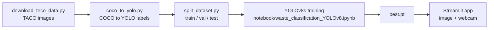

# Waste Detection with YOLOv8 (Team Zero Waste, ITC IIT Bombay)

Object detection for waste segregation: a YOLOv8 model trained on the TACO dataset (60 waste categories) with a Streamlit app for images and live webcam.

## Results

Trained `yolov8s` for 30 epochs (imgsz 640, batch 16) on an 80/10/10 split of about 1,490 TACO images. The table is the best checkpoint evaluated on the **validation split (149 images)**.

| Precision | Recall | mAP@0.5 | mAP@0.5:0.95 |
|:---:|:---:|:---:|:---:|
| 58.2% | 20.4% | 25.3% | 22.1% |

TACO is a small dataset (about 1,490 images spread over 60 categories), so this is a **baseline**. Low recall means many items are missed; the next steps below target that.

## Pipeline



## Quick start

```bash
git clone https://github.com/GunjanRoy4224/Waste-Classifier-YOLOv8.git
cd Waste-Classifier-YOLOv8
pip install -r requirements.txt

cd "streamlit - waste detection"
streamlit run app.py          # uses weights/best.pt
```

To retrain: run the three scripts in `preprocessing/` in order, then the training notebook. `dataset_yolo/dataset.yaml` uses paths relative to its own folder.

## Repository layout

```text
preprocessing/            dataset download, COCO to YOLO conversion, splitting
notebook/                 training and evaluation (waste_classification_YOLOv8.ipynb) plus course exercises
runs/results/train-3/     training curves (results.csv) and weights
streamlit - waste detection/   web app (app.py, helper.py, settings.py)
```

## Limitations and next steps

- Metrics are on the validation split that was also used to pick the best epoch; report held-out test results before quoting these externally.
- Improve recall: stronger augmentation, a larger backbone, grouping rare classes, class-balanced sampling.
- Webcam inference speed depends on hardware; no FPS benchmark is included yet.
